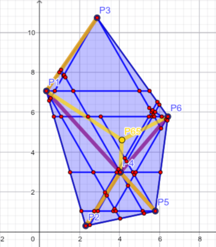
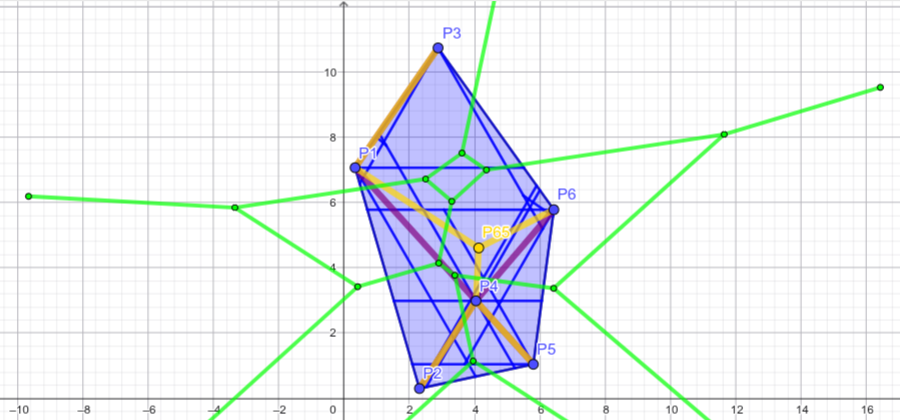

# 1-Steiner Tree Problem

Given a set **P** of n points in the plane (the *sites*), a **Steiner point** is an
extra point added to P, and a **Steiner tree** is a tree connecting P and some Steiner
points. The **1-Steiner tree problem** asks for a single Steiner point **s** that
minimizes the length of a minimum spanning tree (MST) of P ∪ {s}, i.e., produces the best possible
improvement over the length of an MST of P from adding one point; or to determine that
no point shortens the MST.
It should be noted that, just as the MST is not necessarily unique for a point set,
it is possible for multiple Steiner points to produce such a best possible
improvement over the length of an MST.

This program computes a 1-Steiner tree with an implementation of the
Georgakopoulos–Papadimitriou algorithm (GPA), using CGAL with exact arithmetic, and
writes the result as JSON on stdout. I wrote it during my PhD as a research tool: with
an interactive web page that draws its results, and a companion program that draws
higher-order Voronoi diagrams of the same sites, it let me compute exact solutions for
inputs I chose and study their structure, looking for properties of optimal Steiner
points that could lead to better algorithms.

**Reference:** Georgakopoulos & Papadimitriou (1987). The 1-Steiner
Tree Problem. *Journal of Algorithms*, 8(1), 122–130.



*Six sites (P1–P6) and the arrangement this program computes inside their convex
hull (blue), with the MST (purple) and the 1-Steiner tree through the Steiner point
P65 (yellow); edges in both trees appear orange. Drawn by the companion web page.
Made with [GeoGebra®](https://www.geogebra.org) (© GeoGebra GmbH).*

**Version 2.0** reworked the implementation after profiling (details in
[docs/PERFORMANCE.md](docs/PERFORMANCE.md)):

- A degenerate 6-point input went from 6.3 hours to under a second, and 8 random
  points from about an hour and 8.5 GB of memory to 2 seconds and 4 MB.
- Inputs of up to 100 points now run in about 6 minutes on a 4-CPU virtual machine
  (the limit is a constant in the code; rebuild to raise it).
- The geometry is still computed exactly (see [Exactness](#exactness)); the output is
  deterministic; the test suites run clean under AddressSanitizer and
  UndefinedBehaviorSanitizer.

**Quick start** (Linux, with CGAL 4.11.2 built; see [Build](#build)):

```bash
make CGAL_DIR=/path/to/CGAL-4.11.2
./OneSteinerTreeProblem -i "[[0,0],[4,0],[2,3],[5,5]]" -b
```

See [Usage](#usage) for the options and the output format,
[Testing and tools](#testing-and-tools) for the test suites, and
[docs/PERFORMANCE.md](docs/PERFORMANCE.md) for the performance work.

## Context

I wrote this program when I began studying Steiner trees during my PhD, to
experiment with the 1-Steiner tree problem. An interactive web page (JavaScript and
GeoGebra) let me place sites; the server ran this program, and the page drew the
returned JSON: the arrangement, the MST, every candidate Steiner point with its tree,
and the best one. The page could also call a companion program,
[OrderKVoronoiD](https://github.com/anthonydangelo/OrderKVoronoiD), to draw the
order-k Voronoi diagram of the same sites.



*The sites from the picture above, with their order-2 Voronoi diagram (green) from
OrderKVoronoiD drawn over the arrangement and the trees. Made with
[GeoGebra®](https://www.geogebra.org) (© GeoGebra GmbH).*

With these tools I ran many small experiments, looking for patterns in optimal
solutions: where the Steiner point falls relative to the order-k Voronoi cells, which
faces of the arrangement and which sites produce the winning candidate, and how
solutions behave for special configurations, e.g., built from circles and
lenses. The aim was a structural property that could lead to a faster algorithm. The
experiments did not turn up one that we could use; we made progress instead on a
constrained version of the problem:

> Bose, D'Angelo, & Durocher. On the Restricted k-Steiner Tree Problem.
> *Journal of Combinatorial Optimization*, 44(4), 2893–2918 (2022).

The web page is currently offline.

### What this project contributes

- A standalone command-line program (C++11, CGAL) implementing GPA, with JSON output
  for other programs to use, and output modes for large inputs.
- The overlaid oriented Dirichlet cell (OODC) arrangement, built exactly with CGAL
  Nef_2 Boolean operations and arrangement overlays.
- Geometric medians (Fermat–Weber points) of 3 and 4 points, including the
  degenerate cases.
- Candidate evaluation by inserting each candidate into the Delaunay triangulation,
  computing the MST with Kruskal's algorithm, and removing it again.
- A measured, profiling-driven rework for version 2.0, with regression tests,
  checkers and profiling tools (see [Performance](#performance) and
  [Testing and tools](#testing-and-tools)).


## Algorithm

1. **Input:** 3 to 100 sites, given on the command line or generated at random.
2. **Convex hull** of the sites (CGAL's `ch_akl_toussaint`).
3. **OODC arrangement.** Divide the directions around a point into six 60° cones.
   For each site p and each cone direction, the *oriented Dirichlet cell* of p is
   the region of points x for which p is the closest site among the sites in x's
   cone. Each cell is built with CGAL Nef_2 Boolean operations, clipped to the
   convex hull. For each direction, the cells of all sites are overlaid into one
   arrangement (that direction's oriented Voronoi diagram), and the six are then
   overlaid into the *overlaid oriented Dirichlet cell* (OODC) arrangement. Each
   face of it is labelled with its sites: for each direction, the closest site in
   that cone, so at most 6 sites.
4. **Candidates.** For each bounded face, every 3-site and 4-site subset of its
   label gives a candidate Steiner point: the subset's geometric median
   (Fermat–Weber point), the point that minimizes the sum of distances to its
   sites. For 3 sites it is the point where the sites meet at 120°, or the vertex
   of an angle of 120° or more; for 4 sites, the intersection of the diagonals of
   their convex quadrilateral, or the site inside the triangle of the other three
   (GPA, p. 124); for collinear sites, a middle one. A subset that appears in
   several faces' labels gives one candidate: its median is computed and
   evaluated only the first time.   
5. **Evaluation.** Each candidate is inserted into the Delaunay triangulation of
   the sites, the MST is computed with Kruskal's algorithm, and the candidate is
   removed again. (A candidate that coincides with a site gets the sites' MST.)
   The candidates are sorted by tree length; the first is a 1-Steiner point
   (as long as its tree is shorter than the MST).
6. **Output:** JSON with the sites' MST, the candidates and their trees, the OODC
   arrangement and the run time; the output modes `-b`, `-f` and `-o` write less
   (see [Usage](#usage)).

**Why this finds a 1-Steiner point.** A point s is an *optimal Steiner point* if
it minimizes the length of MST(P ∪ {s}) over all points in the plane; the *best
candidate* is the computed candidate with the shortest tree (the first after
sorting). The minimum is never longer than MST(P), since s could be placed at a
site or on an MST edge. If no point gives a shorter tree, the output shows it:
for inputs in general position, the best candidate's tree then has the same
length as the sites' MST. Otherwise, let s be an optimal Steiner point and T an
MST of P ∪ {s}, shorter than MST(P):

- s has 3 or 4 neighbours in T. With 2 or fewer it could not shorten the
  tree (triangle inequality), and a Steiner point of degree 5 never reduces the
  length (Rubinstein, Thomas, and Weng 1992).
- With T's edges fixed, the tree's length depends on s only through the sum of
  its distances to its neighbours, which their geometric median minimizes by
  definition; so we can take s to be that median. A geometric median lies in
  the convex hull of its points (Morrison 2010, Thm. 1), so s lies in the convex
  hull of P. The cells cover the convex hull (each point of it has a site in
  some cone, and lies in the cell of the closest site in that cone), so we can
  let F be the face of the OODC arrangement that contains s (or has s on its boundary).
  This is also
  why we can restrict our search to the convex hull.
- In an MST, s has at most one neighbour in each 60° cone around it, and that
  neighbour is a closest site in the cone (GPA; see also Brazil et al. 2015,
  Lemma 5). So s's neighbours are among F's label. (GPA do not discuss the case
  where s lies on an edge or a vertex of the OODC arrangement, where two sites can
  tie for closest in a cone.)
- Putting it all together, s is the geometric median of a 3- or 4-site subset of F's label: one of
  the candidates. The best candidate's tree is therefore as short as
  MST(P ∪ {s}), and the best candidate is a 1-Steiner point.

**Differences from the paper.**

- **Which subsets.** For each region, GPA try every proper subset of its sites
  (p. 127). This implementation tries only the 3- and 4-site subsets, by the
  degree argument above.
- **Where the candidate may lie.** GPA look for the best point *within the
  region*. This implementation uses the geometric median of the subset
  without restricting its position (and thus it may lie outside the face
  of the OODC whose label the subset came from).
  The result is the same. The argument above shows that the optimal Steiner point s is the
  geometric median of a 3- or 4-site subset of the label of the face F that contains s;
  when this implementation processes F, it computes the median of that subset
  (which is s). Candidates that lie outside their faces are just extra points to
  try: none of their trees is shorter than the optimal one, so they cannot be
  chosen over it (at best they tie with it).  
- **Running time.** GPA build the OODC in O(n²) time and evaluate each candidate
  in O(1) time after O(n²) preprocessing. This implementation builds the cells
  with Nef_2 Boolean operations and recomputes the MST for each candidate (see
  [Complexity](#complexity)).
- **Cone directions.** The 60° cone directions are computed in double precision
  (see [Exactness](#exactness)).

**References**

- Brazil, Ras, Swanepoel, & Thomas (2015). Generalised k-Steiner Tree Problems
  in Normed Planes. *Algorithmica*, 71, 66–86.
- Morrison (2010). The FedEx Problem. *College Mathematics Journal*, 41(3),
  222–232.
- Rubinstein, Thomas, & Weng (1992). Degree-five Steiner points cannot reduce
  network costs for planar sets. *Networks*, 22(6), 531–537.

### Complexity

The costs of the library operations used, as documented by CGAL 4.11.2 and
Boost 1.58 (CGAL computes overlays with its sweep-line algorithm):

| Operation | Used for | Cost |
|---|---|---|
| Nef_2 Boolean operation | each subtraction when building a cell | O(m log m), m = size of the inputs plus the output |
| Overlay of two arrangements (CGAL's sweep line) | per-direction and combining overlays | O((m + k) log m), m = size of the inputs, k = number of intersections |
| `ch_akl_toussaint` | convex hull | O(n log n) |
| Delaunay insertion | adding a candidate | point location by a line walk, O(n) in the worst case (O(√n) on average for random points), then O(d) flips for a new vertex of degree d |
| Delaunay removal | removing the candidate | O(d²) for a vertex of degree d |
| Boost `kruskal_minimum_spanning_tree` | each MST | O(E log E), with E = O(n) edges in a triangulation |

These give the worst-case bounds below, with the measured share of the run time
for 96 random sites:

| Phase | This implementation | GPA (1987) | Measured, n = 96 |
|---|---|---|---|
| Oriented Dirichlet cells (6n cells, n − 1 Nef_2 subtractions each) | O(n³ log n) | O(n²) for the whole OODC | 94% of the time, with the per-direction overlays |
| Overlays (6n adding one cell at a time to its direction's arrangement, then 5 combining the six) | O(n² log n) | (included above) | combining: 0.2% |
| Candidates (O(n²) faces, at most 35 subsets each, de-duplicated) | O(n² log n) | O(n²) | under 0.1% |
| Evaluation (an MST per candidate) | O(n²) each, O(n⁴) total | O(1) each after O(n²) preprocessing | 6% of the time, 97% of the memory |
| **Total** | **O(n⁴)** | **O(n²)** | about n^2.05 measured, up to n = 120 |

How each bound follows:

- **Cells:** a cell can have O(n) edges, so each subtraction costs O(n log n);
  n − 1 of them for each of the 6n cells gives O(n³ log n). 
- **Overlays:** the cells of one direction have disjoint interiors and together
  form that direction's oriented Voronoi diagram, of size O(n). So each of the
  6n overlays that add a cell to its direction's arrangement has inputs of size
  O(n) and only O(n) intersections (the new cell only touches the arrangement
  along shared edges), and costs O(n log n): O(n² log n) in total. In the 5
  overlays that combine the six arrangements, the inputs can have O(n²) size and
  O(n²) intersections (edges of different directions cross), so each costs
  O(n² log n).  
- **Candidates:** O(n²) faces, at most 35 subsets each, de-duplicated in a
  balanced search tree at O(log n) each: O(n² log n).
- **Evaluation**, per candidate: inserting it costs O(n) in the worst case,
  Kruskal's algorithm O(n log n), and removing it O(n²) in the worst case (its
  degree can be O(n)). Finding each MST edge's endpoint indices by searching the
  sites takes O(n) per endpoint, O(n²) per tree. So O(n²) per candidate, and
  O(n⁴) for the O(n²) candidates.

For comparison, GPA note that brute force takes O(n⁶ log n) time. The
arrangement can have Θ(n²) faces, so any method that examines every face, as
this one does, takes Ω(n²) time in the worst case.

The worst-case bottleneck (candidate evaluation) and the measured one (building
the cells) differ. The 6n cells need n − 1 subtractions each, about 6n²
subtractions in total. On random inputs 
the cells stay small, so each subtraction takes roughly constant time (at most
about 6 ms at n = 96, counting the per-direction overlays in that time) and
building the cells takes time proportional to n²;
the O(n³ log n) bound allows for cells with
O(n) edges. Candidate evaluation is cheap at these sizes (about 1.4 ms per
candidate at n = 96), but its O(n⁴) total would eventually dominate for larger
inputs. How each phase could reach GPA's bounds is in
[Limitations and future work](#limitations-and-future-work); the measurements
are in [docs/PERFORMANCE.md](docs/PERFORMANCE.md).

## Exactness

The program computes with exact number types: every coordinate it constructs is
the exact value, not a rounded one, and every geometric test (which side of a
line a point lies on, whether two points are equal, which of two edges is
shorter) gives the true answer. Rounded floating-point arithmetic can get such
tests wrong near ties and degeneracies, which in geometric code leads to crashes
or to subdivisions whose pieces don't fit together. Exact arithmetic is
possible here because a double input is itself an exact rational number (0.1,
as a double, is exactly 3602879701896397 / 2⁵⁵).

There are three deliberate exceptions, each correct up to double rounding:

- **Cone directions.** In CGAL, a *kernel* bundles the basic geometric objects
  (points, lines, directions) and operations (intersections, orientation tests)
  with the number type used for their coordinates. For the kernel used here,
  CGAL's `Compute_cone_boundaries_2` computes the six 60° cone boundaries with
  double-precision `sin`/`cos`, so each is 60° only to within about 10⁻¹⁶
  radians. The program then computes exactly with these directions: exact
  geometry for very slightly rotated cones. This could change a result only when
  a site lies within that distance of a cone boundary and the tie decides the
  answer. It is deliberate: exact 60° directions involve √3, which is not
  rational (see [Number types](#number-types)).
- **3-point geometric medians.** The Fermat-point construction rotates by 60°
  with the same directions, so a median is exact for that rotation. A median
  within 10⁻⁶ of one of its sites is treated as that site.
- **Candidate order.** Candidates are sorted by double approximations of their
  exact tree lengths, so two trees whose lengths agree to about 15 significant
  digits may be listed in either order. Tree lengths are sums of square roots,
  and proving that two of them are exactly equal can take enormous precision; sorting
  exactly made symmetric inputs take hours (see
  [docs/PERFORMANCE.md](docs/PERFORMANCE.md)).

The JSON output prints doubles.

**A visible consequence: sliver faces.** Because the cone directions are not
exactly 60°, a 180° cone boundary through a site is tilted by about 10⁻¹⁶
(`sin(π)` as a double is 1.22 × 10⁻¹⁶, not 0). Where it should coincide with
another boundary, the arrangement gets a sliver face about 10⁻¹⁶ wide. Exact
arithmetic correctly keeps its vertices distinct. Version 1.5 then looked up
vertices for the output by coordinates within 10⁻⁶ and gave such vertices the
same index, which corrupted some faces' vertex lists in the JSON; version 2.0
indexes vertices exactly.

**Making the cones and medians exact** would mean rotating by exactly 60°, using
(1/2, √3/2). CGAL does this in `Compute_cone_boundaries_2` only for its
`Exact_predicates_exact_constructions_kernel_with_root_of` kernel. For the
3-point medians, a few lines of code could apply that exact rotation directly:
they already use `CORE::Expr`, which represents √3 exactly, so this should cost
little (not measured). For the OODC it would mean giving up rational arithmetic
for a number type with square roots, which is much slower (see
[Number types](#number-types)).

### Number types

The program uses two exact number types:

- **OODC construction** (cells, arrangements, overlays): `Lazy_exact_nt<Gmpq>`,
  exact rationals. Every OODC coordinate is rational: the inputs and the cone
  directions are doubles, and every construction is a line through such points
  or an intersection of two lines, which uses only `+ − × ÷`.
- **Geometric medians and MSTs:** `Lazy_exact_nt<CORE::Expr>`, which represents
  square roots exactly. Kruskal's algorithm compares squared edge lengths, which
  need no square roots; the square roots appear only in the tree lengths, which
  are sums of them.

`Lazy_exact_nt` first computes with interval arithmetic in doubles, and computes
the exact value only when the interval is not enough to decide a test. So most
operations run at nearly double speed, and the results are still exact.

The OODC used `CORE::Expr` too, until profiling showed that its arrangements
were tiny (58 vertices for 6 sites) while single overlays took seconds: nearly
all the time went into evaluating CORE expressions. Since the OODC needs no
square roots, rationals give the same results. Switching made it 70 to 170 times
faster on random inputs and cut the memory from about 2 GB to 4 MB for 7 sites (see
[docs/PERFORMANCE.md](docs/PERFORMANCE.md)).

What the switch costs:

- **It commits the OODC to double-precision cone directions.** Exact 60°
  directions involve √3, which is not rational.
- **Two kernels, with conversions between them.** The two kernels have
  different C++ point types, so points passed from one to the other are rebuilt
  in the other's type. The input points and the convex hull are rebuilt in the
  rational kernel once, with their values unchanged (their coordinates are
  doubles, and every double is a rational number). The reverse is not exact:
  most rationals, such as 1/3, have no exact double. So arrangement vertices are
  rounded to doubles, but only for the output.
- **Rational coordinates still grow** through nested intersections; rationals
  avoid CORE's overhead, not that growth.


## Performance

Version 2.0 came from profiling version 1.5 and fixing what the measurements
showed, one change at a time. Each change was checked against the test suites
and tagged in git, so every column below can be rebuilt. Times are wall-clock,
measured on a VirtualBox VM (Ubuntu 16.04, 3.8 GiB RAM; the program is
single-threaded), with peak memory where it was recorded.

| Input | v1.5 | `perf/sort-fix` | `perf/overlay` | `perf/rational-oodc` | v2.0 |
|---|---|---|---|---|---|
| 6 random sites | 102 s, 484 MB | 101 s | 74 s, 518 MB | 1.1 s, 3 MB | 1.1 s, 3 MB |
| 7 random sites | 453 s, 1.8 GB | 311 s, 1.5 GB | 274 s, 2.1 GB | 1.6 s, 4 MB | 1.5 s, 3 MB |
| unit square (4 sites) | 204 s, 352 MB | 1.6 s | 1.4 s | 0.4 s | 0.4 s |
| 6-site grid | 6.3 h, about 20 GB with swap | 5.6 s | 4.6 s | 0.96 s | 0.94 s |
| 8 random sites | 1 h 3 min, about 8.5 GB with swap | | | | 2.0 s, 4 MB |

- **`perf/sort-fix`:** sampling the call stack showed degenerate inputs spending
  nearly all their time sorting the candidates. Tree lengths are sums of square
  roots, and proving that two of them are exactly equal forced the exact number type to
  enormous precision. The candidates are now sorted by double approximations of
  their lengths (see [Exactness](#exactness)).
- **`perf/overlay`:** the cells were overlaid one by one onto a single growing
  arrangement; now each cone direction gets its own arrangement, and the six are
  combined at the end. This is an asymptotic improvement, but a small one at
  these sizes.
- **`perf/rational-oodc`:** memory checkpoints showed tiny arrangements whose
  overlays took seconds each: the cost was the arithmetic, not the size. The
  OODC needs no square roots, so it now uses exact rationals (see
  [Number types](#number-types)).

Time grows about like n^2.05 and memory like n^2.2: 30 sites take 32 s, and 100
sites about 6 minutes (with `-b`; see [Usage](#usage)).
For 96 sites, building the cells takes 94% of the time,
and the candidates' data takes 97% of the memory (probably mostly due to their
exact tree lengths).
The method, each step in detail, and how to reproduce every column are in
[docs/PERFORMANCE.md](docs/PERFORMANCE.md).

## Build

### Dependencies

- g++ with C++11 support
- CGAL 4.11.2, including its compiled libraries (`libCGAL`, `libCGAL_Core`);
  see CGAL's [installation manual](https://doc.cgal.org/4.11.2/Manual/installation.html)
- Boost (thread, system), GMP and MPFR, as required by CGAL

**Tested with:** Ubuntu 16.04.7 LTS, g++ 5.4.0, CGAL 4.11.2, Boost 1.58,
GMP 6.1.0, MPFR 3.1.4.

The code is C++11 and was written in 2018 for CGAL 4.11.2 and g++ 5.4 on
Ubuntu 16.04. Version 2.0 deliberately keeps that toolchain: every performance
improvement in [docs/PERFORMANCE.md](docs/PERFORMANCE.md) is measured with the same
compiler and libraries as the original, so the speed-ups come from the code alone.
Porting to a current CGAL is future work: CGAL 5.0 and later require C++14 and
g++ 6.3 or newer.

### Set `CGAL_DIR`

The Makefile looks for the CGAL libraries in `$CGAL_DIR/lib`, so set `CGAL_DIR`
to your CGAL 4.11.2 build directory. For example, add this line to `~/.profile`,
then log out and back in:

```bash
export CGAL_DIR=/path/to/CGAL-4.11.2
```

Or give it on the command line: `make CGAL_DIR=/path/to/CGAL-4.11.2`. If it is
not set, `make` stops with a message saying so.

The repository includes VS Code build tasks (`build-release`, `build-debug`,
`build-perf`, `build-checkpoints`, `build-asan` in `.vscode/tasks.json`).
VS Code must be started with `CGAL_DIR`
in its environment: `~/.profile` covers VS Code started from the desktop; if you
set it only in `~/.bashrc`, start VS Code from a terminal (`code .`).

### Compile

| Command | Binary | Purpose |
|---|---|---|
| `make` or `make release` | `OneSteinerTreeProblem` | optimized build |
| `make debug` | `OneSteinerTreeProblem_d` | debug build |
| `make perf` | `OneSteinerTreeProblem-perf` | release build with debug symbols, for profilers |
| `make checkpoints` | `OneSteinerTreeProblem-mem` | prints memory use after each phase on stderr |
| `make asan` | `OneSteinerTreeProblem-asan` | AddressSanitizer and UndefinedBehaviorSanitizer build |
| `make variants` | all of the above | builds every binary |
| `make clean` | | deletes the binaries |

All builds except `asan` are statically linked, so the binaries run on other
x86-64 Linux systems without CGAL, Boost, GMP or MPFR installed. Extra compiler
flags go in `EXTRA_FLAGS`, e.g. `make release EXTRA_FLAGS=-DNDEBUG`. Because
`make` does not track flags, use `make -B` to force a rebuild after changing
them.


## Usage

```bash
./OneSteinerTreeProblem -i "[[1,0],[2,0],[3,0],[1,2],[2,2]]"   # given sites
./OneSteinerTreeProblem -n 6 -s 3                              # 6 random sites, seed 3
./OneSteinerTreeProblem -n 50 -b                               # large input, best tree only
```

| Option | Description |
|---|---|
| `-i`, `--inputList "[[x,y],...]"` | Use these sites (in quotes). |
| `-n`, `--numPoints <int>` | Number of sites, from 3 to 100 (default 3). With `-i`: if `-n` is not given, all the given sites are used; if it is, the first n given sites are used, and random sites are added if there are fewer than n. |
| `-s`, `--randSeed <int>` | Seed for the random sites (default 10). |
| `-r`, `--trueRandom` | Seed with the current time instead. |
| `-g`, `--gridLength <int>` | Random sites are drawn uniformly from the square [−g, g) × [−g, g) (g ≥ 1, default 10). |
| `-p`, `--onlyPoints` | Only generate and print the sites. |
| `-b`, `--bestOnly` | Output only the best candidate's tree: no arrangement, no other candidates. |
| `-f`, `--bestWithFaces` | Like `-b`, plus the arrangement faces that could have produced the best candidate. |
| `-o`, `--bestWithOODC` | Like `-b`, plus the whole arrangement. |
| `--no-mutex` | Don't take the lock (see below). |
| `-h`, `--help` | Show the help. |

All options are optional. If more than one of `-b`, `-f` and `-o` is given, the
last one counts; they change only what is written, not what is computed. The
default output lists every candidate's whole tree, which grows like n³: about
380 MB for 96 sites. The maximum of 100 sites is the constant
`MAX_NUM_INPUT_POINTS` in `src/ConstantsAndUtilities.hpp`; rebuild to raise it.

The JSON goes to stdout. The help (`-h`) also goes to stdout; errors and warnings
go to stderr. An invalid value for `-n`, `-s` or `-g` prints a warning and uses
the default. A malformed `-i` list or an unknown option prints the help on stderr
and exits with 1. The program also exits with 1 if writing the output fails (for
example, on a full disk), and with 0 otherwise.

**The lock.** The program was written to run behind a web server, so by default
it takes an exclusive lock (`flock`) on `/tmp/one-st-tree-mutex.lock` before
computing, and concurrent runs wait for each other, without a message. Use
`--no-mutex` to run without it, for example when the calling script manages its
own lock. On a machine shared by several users, the first user's run creates the
lock file readable and writable only by that user, so other users' runs cannot
open it and need `--no-mutex`.

### Output format

```json
{
"compResult": {
  "randSeed": "10",
  "gridLength": "10",
  "inputPoints": [{"x":"1", "y":"0"}, ...],
  "convexHullPoints": [{"index":"0"}, ...],
  "odcArrangement": {
    "arrangementPoints": [{"x":"...", "y":"..."}, ...],
    "arrangementFaces": [
      { "arrFace": {
          "name": "arrFace__0",
          "arrangementFaceCCWVIndices": [{"index":"0"}, ...],
          "arrangementOODCSiteIndices": [{"index":"0"}, ...] } }, ...
    ]
  },
  "minSpanningTree": {
    "mstLength": "7.414...",
    "mstEdgeList": [
      { "mstEdge": {
          "mstEdgeEndpointIndices": [{"index":"0"}, {"index":"1"}],
          "firstEndPointIsSteiner": "false",
          "secondEndPointIsSteiner": "false" } }, ...
    ]
  },
  "candidateStPtDataList": [
    { "candidateStPtData": {
        "steinerPoint": {
          "geomMedPoint": {"x":"...", "y":"..."},
          "geomMedNeighbourIndices": [{"index":"0"}, {"index":"1"}, {"index":"2"}],
          "geomMedCoincidesWithInputPt": "false",
          "geomMedCoincidentInputPtIndex": {"index":"0"} },
        "minSpanningTree": { ... } } }, ...
  ]
},
"elapsedTime": {"s":"0", "m":"0", "h":"0"}
}
```

- All values are JSON strings. Coordinates and lengths are printed with 17
  significant digits, enough to recover the exact double.
- `inputPoints` and `arrangementPoints` are sorted by (x, y), and indices refer to
  positions in these lists. An arrangement face lists its vertices
  counterclockwise (`arrangementFaceCCWVIndices`) and the sites whose oriented
  Dirichlet cells contain it, that is, the closest site in each cone
  (`arrangementOODCSiteIndices`).  
- `minSpanningTree` at the top level is the sites' MST; each candidate has its
  own. An MST edge endpoint flagged as Steiner (`firstEndPointIsSteiner` or
  `secondEndPointIsSteiner`) is that candidate's Steiner point, and its index is
  the candidate's position in `candidateStPtDataList`, counting from 0. A
  candidate that coincides with a site has no Steiner endpoints: its tree is the
  sites' MST. Each edge lists its endpoints in a fixed order (sites by index, the
  Steiner point last), so the same input always gives the same output.
- `geomMedCoincidentInputPtIndex` is meaningful only when
  `geomMedCoincidesWithInputPt` is `"true"`; otherwise it is 0.  
- Candidates are sorted by tree length, best first (see [Exactness](#exactness)
  for the precision of this order).
- `-b`, `-f` and `-o` write only the best candidate. `-b` omits the arrangement,
  `-f` keeps only the faces whose sites include the best candidate's sites, and
  `-o` keeps the whole arrangement. `-p` writes only `randSeed`, `gridLength` and
  `inputPoints`.
- `elapsedTime` is the computation time in whole seconds, not including writing
  the output.

## Testing and tools

The test scripts are in `tests/` (bash, and Python 3.5 or later); each prints its
usage when run without arguments.

### Test suites

A suite is a file `tests/cases-<suite>.txt`, with one case per line: a name, a
description, the program's arguments and, for some suites, the expected result.

| Suite | Cases | Contents |
|---|---|---|
| `120` | 16 | inputs around 120°, the angle at which a triangle's geometric median moves to a vertex: 15 triangles (some scaled or rotated) and one 5-site input, with expected results |
| `regression` | 20 | 14 random inputs of 3 to 6 sites (two with other grid sizes), and degenerate ones: a square, a plus shape, an equilateral triangle with its centre, near-collinear sites, two sites 10⁻⁵ apart, and collinear sites |
| `slow` | 2 | 7 random sites, and 6 cocircular sites |
| `extreme` | 3 | a 6-site grid, plain and rotated by 10° and 37°: degenerate inputs that took 6.3 h, 5 min and over 30 min in v1.5 |
| `scaling` | 9 | 8 to 10 random sites, 3 seeds each |
| `large` | 9 | 30 to 100 random sites, with `-b` |
| `modes` | 6 | checks that `-b`, `-f` and `-o` agree with the full output, on random, symmetric and degenerate inputs |

```bash
tests/run-all.sh ./OneSteinerTreeProblem mylabel                # suites 120, regression, slow, modes
tests/run-all.sh ./OneSteinerTreeProblem mylabel extreme large  # other suites
tests/run-tests.sh compare regression baseline-label mylabel    # compare two runs
```

`run-all.sh` saves each case's output, stderr and exit code under
`tests/out/<suite>/<label>/`. It checks the `120` suite against its expected
results; and it checks every arrangement's face lists with
`check-face-indices.py`, which verifies that each face has at least three
corners, that every index refers to a listed point, and that no vertex appears
twice in a row (counting the last and first corners as adjacent). It also logs
memory activity with `vmstat`. Comparing two runs puts both outputs in a
canonical form first, so a different order of faces or of tied candidates is not
reported as a difference, and it reports each case's time and peak memory (from
GNU `time`). For clean timings, run from a text console with the desktop logged
out.

### Other checks

- **Determinism:** `profiling/check-determinism.sh` runs the same input 50 times,
  50 times with address-space randomisation turned off, and 50 times with `-b`,
  and checks that the outputs are identical (and that `-b` matches the full
  output), e.g. `profiling/check-determinism.sh ./OneSteinerTreeProblem -n 10 -s 2`.  
- **Sanitizers:** `make asan` builds with AddressSanitizer, LeakSanitizer and
  UndefinedBehaviorSanitizer. The suites run clean under it: no memory errors, no
  leaks, and no undefined behaviour in this program's code. UBSan's `vptr` check
  is turned off, because CGAL's arrangement code casts its internal records to
  derived classes, which the check reports hundreds of times per run; two other
  UBSan reports come from inside CGAL 4.11.2 and are documented in the Makefile.
  To compare a sanitizer run with a release run, use
  `IGNORE_STDERR=1 tests/run-tests.sh compare ...`, since the sanitizer's stderr
  differs.
- **Static analysis:** cppcheck (with its warning, style, performance and
  portability checks) reports no issues in `src/`.

### Profiling tools

- `make perf` builds a release binary with debug symbols and frame pointers, so
  profilers can show full call stacks, e.g.
  `perf record -g ./OneSteinerTreeProblem-perf -n 8` and then `perf report`.
- `profiling/sample-backtraces.sh` samples the call stack with gdb every few
  seconds. This "poor man's profiler" works where `perf` cannot unwind the stack,
  such as inside GMP's hand-written assembly. Arguments: output file, seconds
  before the first sample, seconds between samples, number of samples, then the
  command:
  `profiling/sample-backtraces.sh /tmp/stacks.txt 5 10 15 ./OneSteinerTreeProblem-perf -n 7`
  (attaching gdb needs sudo; the script asks once).
- `make checkpoints` builds a binary that prints its memory use after each phase
  on stderr, e.g. `./OneSteinerTreeProblem-mem -n 50 -b > /dev/null`.
- `profiling/explore-size.sh` finds roughly the largest input that runs within a
  time and memory limit, by doubling the number of sites and then bisecting, e.g.
  `EXTRA_ARGS=-b profiling/explore-size.sh`. The search goes up to `MAX_N` sites
  (a setting, default 2048), so first either raise `MAX_NUM_INPUT_POINTS` in the
  source and rebuild, or lower `MAX_N` (e.g. `MAX_N=100`). The script checks
  that the binary can generate `MAX_N` sites (with `-p`) and stops if it can't.  

## Limitations and future work

### Speed and memory

- **Building the cells** (94% of the time at n = 96). Each of the 6n cells takes
  n − 1 Nef_2 subtractions, O(n³ log n) in the worst case. Cheaper options:
  - skip the sites whose region cannot reach the cell, e.g. with a bounding-box
    test before each subtraction;
  - (preferred) build each direction's oriented Voronoi diagram directly, in O(n log n) time
    (Chang, Huang, and Tang 1990). This would replace both the 6n cell
    constructions and the per-direction overlays. Combining the six diagrams
    with CGAL's sweep-line overlay would then cost O(n² log n).
- **Building the arrangement.** If building the six per-direction ODC cell arrangements were O(n²)
  (ideally in O(n log n) time as above), an O(n²) method for building the arrangement
  would bring the whole OODC construction to GPA's bound.
  Options, all O(n²) in our case: 
  the approach described in GPA (Theorem 1); 
  Finke and Hinrichs (1995) (see references below); 
  or Chazelle and Edelsbrunner (1992) followed by
  labelling the faces (see references below).
- **Evaluating the candidates** (O(n⁴) in the worst case, though only 6% of the
  time at n = 96). From most to least improvement:
  - (preferred) constant-time MST updates for each candidate, after
    preprocessing: GPA's O(n²); or better, the O(n log n) preprocessing in Bose,
    D'Angelo, and Durocher (2022) (see also Bose et al. 2004; Monma and Suri
    1992);  
  - without preprocessing: compute the sites' MST once; then, for each candidate,
    run Kruskal's algorithm on its n − 1 edges plus the (at most 6) edges from the
    candidate to its closest site in each of the six cones. These edges always
    contain an MST of the sites and the candidate (Brazil et al. 2015, Lemma 5
    and Theorem 10), so the result is the candidate's MST. With the MST's edges
    sorted once, this takes nearly linear time per candidate, and needs no
    Delaunay updates;    
  - keeping the Delaunay approach: store each vertex's index in the vertex
    (`CGAL::Triangulation_vertex_base_with_info_2`) instead of searching for it
    by coordinates, and start each insertion's point location near the
    candidate (or use `CGAL::Triangulation_hierarchy_2`) instead of walking
    from a fixed face (the default insertion behaviour for the CGAL triangulation).
- **Memory** (97% of it at n = 96 goes to the candidates, about 34 KB each).
  Each candidate keeps its tree and its exact length, a `CORE::Expr` with one
  square root per edge. The sort and the output use only the lengths' double
  approximations, so storing doubles (or computing each edge's length in double
  from the exact squared distance) would remove most of it, at the cost of no
  longer having exact tree lengths.
- **Output size.** The default output lists every candidate's whole tree,
  Θ(n³) in the worst case (about 380 MB for 96 sites); `-b`, `-f` and `-o`
  avoid this by writing only the best tree. A compact full output could give
  each candidate's tree as a change to the sites' MST: by the Brazil et al. result above, it
  consists of edges of the sites' MST plus at most 6 edges at the candidate, so
  at most 6 edges removed and 6 added. The whole output would then be O(n²).
  The companion web page would need updating to read it.

### Robustness of the results

- **MST ties.** Kruskal's algorithm breaks ties between equal-length edges in
  the triangulation's edge order, which depends on memory addresses. For inputs
  with several MSTs of the same length, which one is printed could vary between
  runs; sorting the edges by length and then by endpoint indices would make it
  deterministic. (The determinism check above found no variation, but it does
  not cover such inputs specifically.)
- **Exactness.** The cone directions and 3-point medians are exact only up to
  double rounding, and the candidates are sorted by double approximations of
  their lengths; see [Exactness](#exactness) for why, and what making them
  exact would take.
- **Tolerances.** Sites are assumed to differ by at least 10⁻⁶ in some
  coordinate: random sites closer than that are redrawn, but given sites are
  not checked. A 3-point median within 10⁻⁶ of a site is treated as that site.
  These tolerances are absolute, so they depend on the input's scale.
- **Collinear sites.** If all the sites are collinear, the convex hull has no
  interior and there are no candidates.
- **Points on face boundaries.** The argument "Why this finds a 1-Steiner
  point" (in [Algorithm](#algorithm)) assumes the optimal Steiner point lies
  inside a face of the arrangement. If it lies on an edge or a vertex, two sites
  can tie for closest in a cone, and it remains to show that all its neighbours
  still appear together in the label of one face around it, or that this case
  cannot happen.

### Practical limits

- **Input size.** At most 100 sites, a constant in the code (see
  [Usage](#usage)).
- **The lock** is meant for a web server, and gets in the way elsewhere (see
  [Usage](#usage)): concurrent runs wait silently, and on a shared machine other
  users need `--no-mutex`. Turning it off by default, with a flag for the
  server, would suit command-line use better.
- **Toolchain.** C++11, CGAL 4.11.2 and g++ 5.4; porting to a current CGAL
  needs C++14 or later (see [Build](#build)).

**References**

- Bose, D'Angelo, & Durocher (2022). On the Restricted k-Steiner Tree Problem.
  *Journal of Combinatorial Optimization*, 44(4), 2893–2918.
- Bose, Maheshwari, Narasimhan, Smid, & Zeh (2004). Approximating geometric
  bottleneck shortest paths. *Computational Geometry*, 29(3), 233–249.
- Chang, Huang, & Tang (1990). An optimal algorithm for constructing oriented
  Voronoi diagrams and geographic neighborhood graphs. *Information Processing
  Letters*, 35(5), 255–260.
- Chazelle & Edelsbrunner (1992). An optimal algorithm for intersecting line
  segments in the plane. *Journal of the ACM*, 39(1), 1–54.
- Finke & Hinrichs (1995). Overlaying simply connected planar subdivisions in
  linear time. *Proceedings of the 11th ACM Symposium on Computational
  Geometry*, 119–126.
- Monma & Suri (1992). Transitions in geometric minimum spanning trees.
  *Discrete & Computational Geometry*, 8, 265–293.  

Brazil et al. (2015) is listed under [Algorithm](#algorithm); its Theorem 10
cites Korte and Vygen, *Combinatorial Optimization* (Springer, 2008),
pp. 120–121.

## Related work

- Payne, Ras, & Volz (2020). Overlaid oriented Voronoi diagrams and the
  1-Steiner tree problem. arXiv:2002.06752. An independent implementation, also
  using CGAL, of the OODC arrangement (which they call the overlaid oriented
  Voronoi diagram) and of a 1-Steiner algorithm based on it, with experiments on
  random inputs and methods for processing the arrangement that reduce the
  construction time by about a factor of 12. The program in this repo was written in 2018,
  before that paper.  
- Bose, D'Angelo, & Durocher (2022). On the Restricted k-Steiner Tree Problem.
  *Journal of Combinatorial Optimization*, 44(4), 2893–2918. Among other results,
  an O(n log n) preprocessing after which each candidate's MST length can be
  found in constant time; this implementation does not use it yet.
- Brazil, Ras, Swanepoel, & Thomas (2015). Generalised k-Steiner Tree Problems
  in Normed Planes. *Algorithmica*, 71, 66–86. The k-Steiner tree problem, with
  k added points, in normed planes.

## License

This project is licensed under the **GNU General Public License v3.0 or later**
(see [LICENSE](LICENSE)). It uses CGAL packages (Nef_2, Arrangement_on_surface_2,
Triangulation_2, Convex_hull_2) that are themselves licensed under the GPL v3 or
later. This software is provided "as is", without warranty of any kind; see the
LICENSE file for details.

### Attribution

The EMST computation (a Delaunay triangulation, then Kruskal's algorithm on a
Boost Graph Library filtered graph) is derived from CGAL's
[`BGL_triangulation_2/emst.cpp`](https://doc.cgal.org/4.11.2/BGL/BGL_triangulation_2_2emst_8cpp-example.html)
example. CGAL is available at https://www.cgal.org.

### Acknowledgements

The original implementation (2018) is my own. The 2026 work on this repository
was done with help from AI assistants: Brave Leo early on, then Claude
(Anthropic). Claude proposed and drafted most of the 2026 changes to the C++
code, which I reviewed and applied by hand; it also wrote the test and
profiling scripts in `tests/` and `profiling/`, helped interpret the profiling
results, and drafted parts of this README and of `docs/PERFORMANCE.md`.
